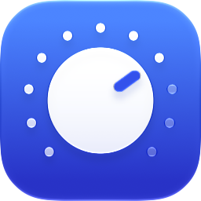

<div align="center">



# SwiftDenon

**A small, modern remote for Denon and Marantz network receivers. Built in SwiftUI for macOS 26, with Liquid Glass and no dependencies.**

It finds your receiver on the network by itself and keeps a live connection to it, so what you see is always what the amp is doing, even when someone else grabs the physical remote. Power, volume, mute, inputs and every zone in one small window, plus a menu bar controller and Shortcuts actions for when you don't want a window at all.

<br>

<!-- Screenshots coming soon:
 &nbsp; 
-->

</div>

## Features

- **Live state**: the receiver pushes every change, so volume, mute and input stay in sync with the front panel and other remotes, without polling
- **Finds your receiver**: scans the local network and connects on its own, then finds it again if its address changes
- **Every zone**: Main, Zone 2 and Zone 3, each with its own power, volume, mute and input, with names you choose
- **Your inputs, your names**: input names and hidden inputs come straight from the receiver's setup
- **Instant feedback**: controls react immediately and reconcile with the amp, so nothing jumps back while the receiver catches up
- **Smooth volume**: a glass slider that follows your pointer, with optional 0.5 dB half steps on zones that support them
- **Sound settings**: sound mode, dynamic EQ, bass, treble and subwoofer faders, sleep timer
- **Menu bar controller**: zones, power, volume, mute and input from the menu bar, with an icon that shows whether the zone is on or muted
- **Shortcuts**: power, volume, mute and input actions
- **Demo mode**: try everything against a simulated receiver, no amp needed
- **Minimal footprint**: native SwiftUI, one small window, no third-party code

## Installation

There are no releases yet. Build it from source (see [Development](#development)).

| Platform | Status |
|----------|--------|
| macOS 26 or later | Supported |
| iOS 26 or later | In progress |

Developed and tested against a Denon AVR-X2700H. Other Denon and Marantz receivers with network control should work.

## Setup

1. Turn on network control on the receiver: **Setup → Network → Network Control → Always On**
2. Open SwiftDenon and allow **Local Network** access when macOS asks. Discovery and control both need it
3. That's it. It finds the receiver and connects. If it doesn't, enter the address manually under **Settings → Amp**

## Using it

| Action | Result |
|--------|--------|
| **↑ / ↓** | Volume up or down |
| **← / →** | Previous or next input |
| **Space** or **M** | Mute or unmute |
| **P** | Turn the zone on or off |
| **1 / 2 / 3** | Switch to Main, Zone 2 or Zone 3 |
| **Tab** | Next zone |
| **Drag** the slider | Set the volume. Fast drags skip half steps |
| **Click** the zone picker | Switch between zones |
| **Click** the input name | Pick an input |
| **Click** the gear | Settings: Amp, Zones and General |

Turn on **Settings → General → Arrow keys switch zones** to swap them: ←/→ then switch zones and Tab steps through inputs. If you'd rather not have a slider at all, **Hide volume slider** puts − and + either side of the number.

The menu bar icon opens a compact controller with the same controls: zone switcher, volume, mute, power and input, plus ↑/↓, Space, P and Tab. The icon is filled while the zone is playing, outlined when it's off and crossed out when muted. **Open SwiftDenon** brings the window back if you closed it, and **Settings → General → Show in menu bar** hides it.

Zone names live in the app, because receivers don't expose them over the network. Set them under **Settings → Zones**.

## How it talks to your receiver

Denon and Marantz receivers have a plain-text control protocol on TCP port 23. SwiftDenon keeps one connection open and the receiver pushes a status line whenever anything changes, whether from the app, the front panel, the IR remote or another app. That's why it can stay live without polling.

A few things learned the hard way are built in:

- **Main zone off doesn't mean everything off.** `PWSTANDBY` puts every zone to sleep, so the main zone uses `ZMON` / `ZMOFF` instead and Zone 2 keeps playing.
- **Commands are spaced 50 ms apart.** Receivers silently drop commands that arrive faster.
- **Optimistic, but honest.** Each change shows up immediately and is held until the receiver confirms it, or released after a short timeout, so stale status lines can't flicker the UI back.

Discovery probes the local subnet on port 23 and only accepts hosts that answer like a receiver, reading the name you gave it on the amp.

See [docs/DENON_PROTOCOL.md](docs/DENON_PROTOCOL.md) for the commands used and the quirks found on real hardware.

## Development

**Prerequisites:** Xcode 26 or later, [XcodeGen](https://github.com/yonaskolb/XcodeGen) (`brew install xcodegen`)

```bash
# Generate the Xcode project from project.yml
xcodegen generate

# Build without signing
xcodebuild -project SwiftDenon.xcodeproj -scheme SwiftDenon \
  -destination 'platform=macOS' -derivedDataPath build CODE_SIGNING_ALLOWED=NO build

# Test the protocol layer
cd Packages/ReceiverKit && swift test
```

Or open `SwiftDenon.xcodeproj`, set your signing team and run the SwiftDenon scheme.

Two parts: `ReceiverKit` is a pure Swift package with the brand-neutral `Receiver` protocol, the Denon driver, a demo receiver and discovery, all unit tested without hardware. `App/` is the SwiftUI app. Adding another brand means writing one more `Receiver`. `tools/fake_avr.py` impersonates a receiver for UI testing without touching a real amp. The app icon is an Icon Composer document at `App/AppIcon.icon`.

| Doc | What's in it |
|-----|--------------|
| [docs/ARCHITECTURE.md](docs/ARCHITECTURE.md) | Package and app layout, data flow, optimistic updates, window sizing |
| [docs/DENON_PROTOCOL.md](docs/DENON_PROTOCOL.md) | Commands used and quirks learned from real hardware |
| [docs/DESIGN.md](docs/DESIGN.md) | UI principles, the reasoning behind each decision, the icon |
| [docs/TESTING.md](docs/TESTING.md) | Unit tests, demo mode, wire log, fake receiver, debug flags |
| [docs/DEVELOPMENT_LOG.md](docs/DEVELOPMENT_LOG.md) | How the app was built, request by request |
| [docs/ROADMAP.md](docs/ROADMAP.md) | Known gaps and ideas |

<!-- Screenshots coming soon:
## Screenshots

<details>
<summary>More screenshots</summary>
<br>

 &nbsp; 

 &nbsp; 

 &nbsp; 

(Screenshots taken of version 1.0 on macOS 26)
</details>
-->

## License

[MIT](LICENSE)
